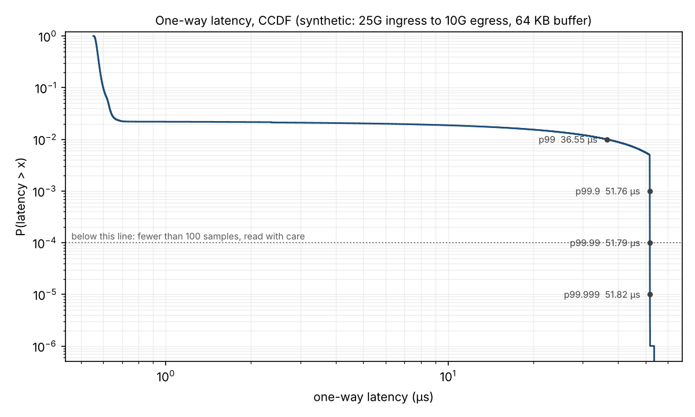
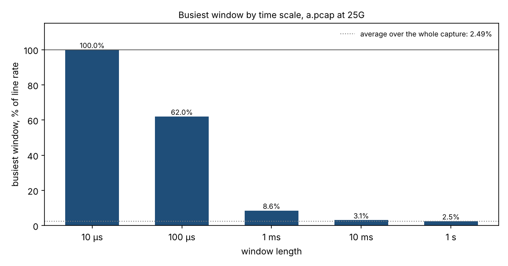

# pcaplat

[](https://github.com/zizco/pcaplat/actions/workflows/tests.yml)

One-way latency, tail statistics and burst analysis from packet captures taken at two points of a network path.

Give it a capture from point A (say, a tap on the market-data feed into a switch) and a capture from point B (a tap on the way out). It finds the same packets in both, computes the one-way latency of each one, and writes a report that states the three things a latency number needs before it means anything:

1. **the distribution**, with the number of samples ranked beyond each percentile and a confidence interval;
2. **where the timestamps were taken** at each end;
3. **which clock took them**, and how large its error is compared with the effect being measured.

It also looks at a single capture across time scales, to show microbursts that one-second counters average away.

```
$ pcaplat latency a.pcap b.pcap --clock-error 5ns --out report/
matched 992,468, lost 7,482; p50 572 ns, p99.99 51.79 µs; report in report/report.md
```



## Why another tool

Most latency figures that circulate inside a firm are a mean, or a single percentile, from a sample whose size nobody states, between two clocks whose offset nobody measured. pcaplat is built to make those omissions visible:

- **Every percentile reports how many samples are ranked beyond it.** A p99.99 from 20,000 samples has two points in its tail; the report flags it instead of printing it as if it were stable. As a rule of thumb you need around a million samples for a p99.99 you can compare across runs.
- **Confidence intervals are distribution-free.** For continuous data, the number of samples below the true q-quantile follows Binomial(n, q), so the interval ranks are chosen from that distribution, with no assumption about the shape of the latency distribution. With ties, which integer nanoseconds and coarse clocks produce, the same order-statistic interval still covers the true quantile at least as often as stated: ties make it conservative, never too narrow. When the sample is too small, the interval is reported as unbounded rather than falsely narrow: with 1,000 samples, a p99.99 has no finite upper bound. The intervals assume independent, identically distributed samples. Latencies measured during a burst are positively correlated, which usually makes the real uncertainty larger.
- **Lost packets are not silently dropped from the statistics.** A loss-aware table counts each lost packet as infinitely late. With 0.75% loss, a p99.9 that looks like 52 µs is really "lost". Losses, the loss rate and that table are all computed on one population of packets, the loss cohort, and the report accounts for every member of it (see "Loss cohort" below).
- **Absolute timestamps stay in integer nanoseconds.** A float64 holding an epoch time in nanoseconds can only represent multiples of 256 ns. That is enough to corrupt a nanosecond capture without any visible error (see "Pitfalls" below: this project's own first draft fell into it twice). Only latencies and times relative to the first packet, which are small numbers, are converted to floating point. Resolutions finer than 1 ns are truncated to whole nanoseconds.
- **The report says which clock was used, and does not guess.** With two capture devices, every sample carries their offset. One file with two interfaces does not prove one clock (captures can be merged), so the single-clock case is only reported when you state it with `--same-clock`.

## Install

Python 3.10 or later.

```
git clone https://github.com/zizco/pcaplat.git
cd pcaplat
pip install .            # or: pip install -e ".[test]" for development
```

Dependencies: numpy, pandas, pyarrow, matplotlib, scipy.

## Quick start on synthetic data

The `synth` command writes two captures with a known latency distribution: market data on a 25G link with exponential gaps (a Poisson process, each gap floored at the frame's serialization time), periodic bursts at 25G line rate into a 10G egress with a 64 KB buffer (so a queue builds and overflows), a rare second latency mode, random drops, heartbeats with identical payloads and some cross traffic seen only at B.

```
pcaplat synth --out demo --packets 1000000 --rate-pps 600000
pcaplat latency demo/a.pcap demo/b.pcap --out demo/report \
    --label "25G ingress to 10G egress" --clock-error 1ns
pcaplat bursts demo/a.pcap --line-rate 25G --out demo/bursts
```

The test suite checks that pcaplat recovers the injected latency of every delivered packet exactly, packet by packet, and the injected losses.

## Measuring your own path

On each Linux host that captures, check it, then capture. Start B first and stop it last.

```
sudo pcaplat doctor eth1                     # hardware timestamps? NIC clock synchronized? coalescing?
sudo pcaplat capture -i eth1 -w b.pcap --filter 'udp and dst port 31001' --duration 330s   # host B
sudo pcaplat capture -i eth1 -w a.pcap --filter 'udp and dst port 31001' --duration 300s   # host A
```

Then, anywhere:

```
pcaplat info a.pcap b.pcap
pcaplat latency a.pcap b.pcap --label "feed handler NIC to order gateway NIC" --clock-error 50ns --out report/
```

`pcaplat capture` runs tcpdump with nanosecond files, the NIC hardware clock when there is one, and a large buffer, and writes a metadata file next to each capture (timestamp source, PTP check, packets dropped by the capture path, completion status). The latency report reads it, so it states where the timestamps came from and warns when "lost" packets may be capture drops. Plain tcpdump works too.

[docs/MEASURING.md](docs/MEASURING.md) is the full guide: choosing capture points (taps, NIC timestamps, why not SPAN ports), clocks and PTP, capturing without drops, choosing the key, reading the report, and a troubleshooting table.

## Commands

### `pcaplat latency A B`

Matches packets between two captures and writes `report.md`, `summary.json`, `ccdf.png` and `latencies.parquet` (one row per matched packet: key, both timestamps, latency, length, FCS bytes, cohort membership). The load at A is estimated from start timestamps alone, as the n-1 frames that open the n-1 intervals between the first and last packet, so the traffic counted and the time it is divided by cover the same frames. `summary.json` is strict JSON (RFC 8259), readable by any parser: a value that is infinite (a lost or late packet ranked as infinitely late, an unbounded interval end) or undefined (a statistic of an empty sample) is written as `null`, with a sibling field `<name>_nonfinite` set to `+inf`, `-inf` or `nan`; `bursts.json` follows the same rule. The CCDF uses a log latency axis, or a symmetric-log axis with a marked zero when negative latencies were kept with `--allow-negative`, so they stay visible.

| Option | Meaning |
|---|---|
| `--key` | How packets are identified at both points (see below). Default `l4payload`. |
| `--dst-ip`, `--dst-port`, `--proto` | Keep only matching packets, e.g. one multicast group. |
| `--max-latency` | Pairs later than this are reported as late (seen at both points), not as matched, lost or extra. Default `1ms`. |
| `--allow-negative` | Keep negative latencies down to this value (useful while hunting a clock offset). |
| `--iface-a`, `--iface-b` | With a single pcapng holding both points, the interface index of each (see `pcaplat info`). |
| `--same-clock` | State that one device timestamped both points. Never assumed. |
| `--label`, `--ts-source-a`, `--ts-source-b`, `--clock`, `--clock-error` | Measurement metadata, copied into the report. |
| `--percentiles`, `--min-tail` | Percentiles to report (between 0 and 100), and the number of samples ranked beyond a percentile needed to call it reliable (default 100). |

### `pcaplat bursts FILE --line-rate 10G`

For each window length (default 10 µs, 100 µs, 1 ms, 10 ms, 1 s) finds the busiest window in the capture and reports it as a fraction of line rate. Bits on the wire include FCS, preamble and inter-frame gap; the FCS is not added twice when the capture metadata says it is already in the frame (pcap FCS flag, pcapng `if_fcslen` per interface, or the FCS length in a packet's `epb_flags`), or with `--fcs-included`. The same per-packet FCS information is used for the load figure of the latency report.

Only frames that start and finish serializing inside a window are counted, each with its own completion time, so a short frame that finishes before a long one is not lost in a fan-in capture. On a single link, the peak can exceed 100% only through timestamp rounding, by about two timestamp resolutions over the window length; a peak beyond line rate plus that allowance is flagged as fan-in: the capture point aggregates several links, or the metadata is wrong (line rate, frame lengths or timestamps). The formula assumes Ethernet frames whose timestamps mark the start of the frame; captures that timestamp the end of the frame, or in software, shift every window. The average is taken from the first frame's start to the last frame's end. Windows longer than the capture are marked not applicable. The computation is exact and takes O(n log n) time whatever the traffic looks like, including many frames sharing one timestamp.



On the synthetic capture above, the busiest 10 µs is at line rate, while the busiest second is at 2.5%: the same traffic, seen at two time scales.

### `pcaplat doctor IFACE` and `pcaplat capture -i IFACE -w FILE`

`doctor` checks a Linux capture host: tcpdump, NIC hardware timestamps (`ethtool -T`), the timestamp types tcpdump can use, interrupt coalescing, and whether ptp4l actually disciplines this NIC's clock (a hardware-timestamping SLAVE port on this clock, among all the ports that share it; a grandmaster confirmed present; offset samples). Without that evidence it reports the clock as not verified. Offset samples show variation only; the guide explains how to bound the constant bias. `capture` runs tcpdump with the right options (`--filter`, `--duration`, `--count`, `--snaplen`, `--timestamp auto|hardware|host`, `--buffer-mb`) and writes `FILE.json` with the capture metadata, including whether tcpdump completed normally; a failed capture makes the command fail. `capture` needs root, or CAP_NET_RAW and CAP_NET_ADMIN. `doctor` also runs as an ordinary user, but then says so and reports less, because listing tcpdump's timestamp types and querying ptp4l usually need the same privileges.

### `pcaplat info FILE...` and `pcaplat synth`

Interfaces (with their section, resolution, FCS length and timestamp offset), packet counts and any malformed data the reader skipped; synthetic data generator.

## Capture formats

pcap (microsecond and nanosecond, both byte orders, FCS flag in the link-type field) and pcapng (several sections and interfaces, each with its own byte order, `if_tsresol` in base 10 or base 2, `if_tsoffset`, `if_fcslen` in bits as the specification defines it, and the per-packet FCS length in octets from `epb_flags`, which overrides the interface value). Interfaces are numbered across the whole file, so two sections that both start at interface 0 stay distinct.

The reader checks the structure it relies on and reports what it cannot use instead of skipping it silently:

- pcap: an incomplete last record, bytes after the last record;
- pcapng sections: a byte-order magic other than the two valid encodings, a header shorter than its 28 mandatory bytes (both an error if it is the first block), a major version other than 1;
- pcapng blocks: a trailing length that differs from the leading length, bytes left over after the last complete block;
- interface descriptions: a block too short to read, an option that runs past its block, an `if_tsresol` or `if_tsoffset` of the wrong length or repeated with a different value (the specification allows each once). A repeat with the same value is reported and accepted; a contradictory `if_fcslen` is reported and ignored. Timestamp metadata is never guessed: a missing `if_tsresol` means microseconds, as the specification says, but a malformed or contradictory one makes that interface's timestamps unreadable, and its packets are skipped and counted rather than read at a resolution that could be wrong by orders of magnitude. Later interfaces keep their numbers;
- packets: a reference to an unknown or unreadable interface, more captured bytes than the block holds, malformed packet options (the packet is kept, its options ignored), an original length below the captured length (corrected to the captured length, as the pcap specification allows), simple packet blocks and obsolete packet blocks, which pcaplat does not read.

Packet-level problems are counted by kind, with the position of the first one. `pcaplat info` lists them, and the latency and burst reports repeat them. Other block types (name resolution, interface statistics, decryption secrets, custom blocks) carry no packets and are skipped by design.

## Matching keys

A packet is identified by a 64-bit hash of fields that do not change between the two points. Which fields are safe depends on what sits in between.

| Key | Hashes | Use when |
|---|---|---|
| `l4payload` | IP addresses, protocol, ports, L4 payload | The path routes packets (TTL, checksum and MAC addresses change). Default. |
| `frame` | Every byte up to the end of the IP packet | The device in between rewrites nothing (layer 1 or layer 2 switching). |
| `bytes:O:L` | IP addresses, protocol, ports, and L payload bytes from offset O | You know where a unique field sits, e.g. the sequence number in a market-data header. |

Payload boundaries come from the IP and UDP length fields, never from the captured frame length. Ethernet minimum-size padding and vendor timestamp trailers appended after the IP packet are therefore excluded, and the same packet hashes identically at both points.

Headers with impossible lengths are rejected rather than read: an IPv4 header below 20 bytes or longer than the packet, a UDP length below 8 or beyond the IP packet, a TCP data offset below 5 or beyond the IP packet, an IPv6 extension header or authentication header running past the IPv6 payload. Upper bounds are checked against the length the IP header declares, not the captured length, so a valid packet cut by the snap length is classified as truncated, not malformed. A first fragment may declare a transport length that spans later fragments.

Packets whose identity cannot be established are not keyed, and the report counts them:

- **Cut by the snap length** (`l4payload` and `frame` keys): two different packets can share the same captured prefix. The `bytes` key still works if the field itself was captured.
- **IP fragments** (`l4payload` and `bytes` keys): a fragment's payload is not the datagram's payload, and later fragments carry no transport header. The `frame` key, which includes the IP identification and fragment offset, still keys them.

A key that appears more than once in either capture (heartbeats, retransmissions, repeated payloads) is ambiguous and is excluded from both captures, so that a duplicate on one side does not become a false loss or false extra packet on the other.

**Loss cohort.** Losses are counted on the packets seen at A while B was capturing and early enough for B to see them (between B's first packet and B's last packet minus `--max-latency`, counting every packet captured at B, keyed or not), so a capture that started late is not reported as packet loss, and a B capture whose packets are all unusable as keys (heartbeats only, say) still bounds the cohort. Every cohort member is exactly one of four things, and the report shows the breakdown:

| Cohort member | Matched table | Loss-aware table |
|---|---|---|
| Matched within the window | yes | ranked at its latency |
| Late: seen at B after `--max-latency` | no | ranked as infinitely late |
| Clock-invalid: seen at B before A beyond `--allow-negative` | no | not ranked (no meaningful latency), counted |
| Lost: never seen at B | no | ranked as infinitely late |

The loss rate is lost packets over the whole cohort, clock-invalid members included: they did reach B. Late packets sent outside the cohort are reported, but enter neither the loss rate nor the loss-aware table, and the report says so. Matched packets sent outside the cohort are in the matched table only.

## Pitfalls this tool guards against

| Pitfall | What happens | What pcaplat does |
|---|---|---|
| Epoch timestamps in float64 | Quantized to 256 ns at today's epoch | Integer nanoseconds for absolute timestamps; burst windows computed relative to the first packet |
| Percentile rank in binary floating point | 99.9 / 100 is 0.9990000000000001, so 1000 times it rounds up to rank 1000 | Exact rational arithmetic for ranks |
| Normal-approximation confidence intervals in the tail | A "95%" interval for p99.99 from 1,000 samples covers the true value 9% of the time | Exact binomial ranks; unbounded when the data cannot bound it |
| Ethernet padding, timestamp trailers | Same packet hashes differently at A and B | Lengths taken from IP and UDP headers |
| Snap-length truncation, IP fragments | Different packets share a key: false matches | Not keyed by payload; counted in the report |
| A duplicate on one side only | False loss, or false extra traffic | Ambiguous keys excluded from both sides |
| Loss counted on one population, divided by another | Loss rate understated or overstated | One cohort, with every member accounted for; clock-invalid packets stay in the denominator; bounds taken from every captured packet |
| Header lengths that overrun the IP packet | A malformed packet matches a valid one | Upper bounds checked against the declared IP length, snap-length truncation handled separately |
| FCS metadata in mixed units | pcapng `if_fcslen` is in bits, `epb_flags` in octets: FCS counted twice or wrongly | Units as specified, per-packet override, per-packet wire length |
| Corrupt or contradictory pcapng timestamp options | Read at a default or arbitrary resolution, wrong by orders of magnitude | Interface reported unreadable and its packets counted; only a missing option falls back to the specified default |
| Infinity and NaN written into JSON | Strict parsers (JavaScript, many JSON libraries) reject the whole report | `null` plus an explicit `_nonfinite` field; serialized with non-finite numbers forbidden |
| Microsecond captures, or mixed resolutions | Sub-µs results look precise but are not | Resolution tracked per packet, flagged for the interfaces actually used |
| Two interfaces in one file | Assumed to share a clock | Single clock only when stated with `--same-clock` |
| Losses removed from statistics | The tail looks better than the service | Loss-aware percentile table |
| Too few tail samples | p99.99 from a handful of points | Samples ranked beyond each percentile reported and flagged |

## Performance

Decoding is vectorized with numpy for the common case (Ethernet, up to two VLAN tags, IPv4 including fragments, UDP or TCP). Other packets (IPv6, Linux cooked capture, raw IP, three or more VLAN tags, malformed headers) go through a scalar decoder; a test checks that both paths produce identical results.

On the 2-vCPU cloud machine used for development, the full `latency` command on the synthetic example (A holds 1,000,000 packets and B 992,718, about 118 MB per file) takes 7 to 8 seconds. Best of three runs per stage: reading both files 1.0 s, decoding and hashing 3.2 s, matching and loss accounting 1.3 s, statistics under 0.1 s, the rest being the plot and the report. The burst analysis of the million-packet capture at five time scales takes 0.7 s. On an 8-CPU machine, runs on several recent revisions took 6.7 to 7.3 s. Stage proportions depend on the machine. The Python pipeline runs its stages one after the other; numpy, pandas and pyarrow may use several threads internally, and nothing restricts them. Capture files are memory-mapped, so packet bytes are not copied.

## Limitations and roadmap

- No automatic estimate of the offset between two clocks yet. Planned: estimate it from the minimum-latency envelope over time, and report drift.
- Confidence intervals assume independent samples; a block-based estimate for correlated samples would be more honest for bursty traffic.
- IP fragments are not reassembled, and IPv6 ESP is not decoded (the authentication header is skipped correctly).
- Vendor timestamp trailers (for example from layer 1 switches or capture NICs) are excluded from the hash but not yet parsed as timestamp sources.
- TCP retransmissions are treated as ambiguous keys, not reconstructed. A unique key in each file is not proof of physical identity: prefer an application sequence number (`bytes` key) when one exists.
- `doctor` and `capture` are for Linux capture hosts (they drive tcpdump, ethtool and linuxptp). The analysis commands run anywhere Python runs.
- ERF and other capture formats are not supported yet.
- Decoding and hashing is the slowest stage here. A compiled core (Rust or numba) is the obvious next step for captures of hundreds of millions of packets.

## Validation against independent implementations

The unit tests build captures with pcaplat's own writer or by hand, which could in principle share a misreading of the formats with the reader. The `validation/` folder removes that circularity:

- `third_party_writers.py` writes 3,000 mixed packets (UDP, VLAN, QinQ, TCP with options, IPv6, frames padded to the 60-byte Ethernet minimum) with two independent libraries in four writer configurations: scapy nanosecond pcap, scapy pcapng, dpkt nanosecond pcap and dpkt microsecond pcap. pcaplat must return the same timestamps as scapy reading the same file, identical packet bytes, and the same ports and L4 payload as scapy's dissection. All four pass. Scapy reads the host's network interfaces when it is imported, which some restricted sandboxes forbid.
- `kernel_loopback.py` (Linux, root) captures real traffic with an AF_PACKET socket on the loopback interface. Each datagram is seen twice, on transmit and on receive, with kernel nanosecond timestamps: a genuine two-point measurement on one clock. The two views are written with dpkt, analysed with pcaplat, and compared with latencies computed independently from the raw socket data. In an early run, one datagram took 1.9 ms, beyond the default 1 ms window, and an earlier draft counted it as both lost and extra traffic. It is this real capture that showed late packets must be reported as late. In every run since, all latencies were identical to the reference.

```
pip install -e ".[validation]"
python validation/third_party_writers.py /tmp/out
sudo python validation/kernel_loopback.py /tmp/out 20000
```

## Adversarial testing

Beyond the unit tests, the tool went through ten rounds of adversarial review: hostile captures built byte by byte, malformed files, fault injection, and a check of every claim in this README. The first five rounds found 35 defects in the analysis; none of the five rounds since found any there. Rounds eight and nine also reviewed the new capture helpers and found 6 defects in them, the most serious a host check that took a running ptp4l, or a missing answer from it, as proof that the NIC clock was synchronized, and a failed tcpdump reported as a successful capture. The tenth round found nothing new. Most of the 41 were not crashes but plausible wrong numbers or false assurances: a loss rate on the wrong denominator, a 95% interval that covered the true p99.99 about 9% of the time, an FCS counted twice, a 100 ms outlier missing from the plot, `Infinity` written into JSON. Each code defect is reproduced by a test written to fail on the code that had it; the documentation findings were fixed in the text.

## Tests

```
pip install -e ".[test]"
pytest
```

160 test cases. They cover the pcap and pcapng readers, including malformed and contradictory files; the equivalence of the vectorized and scalar decoders, also on fuzzed headers; keys across Ethernet, Linux cooked capture and raw IP; exact recovery of injected latencies, packet by packet, and of injected losses; the loss cohort; the statistics; the burst analysis against a brute-force oracle; the report and JSON output; and the capture helpers, on recorded tcpdump, ethtool and pmc outputs, plus a real loopback capture when the tests run as root on a host with tcpdump that allows packet capture.

## License

MIT. See [LICENSE](LICENSE).
